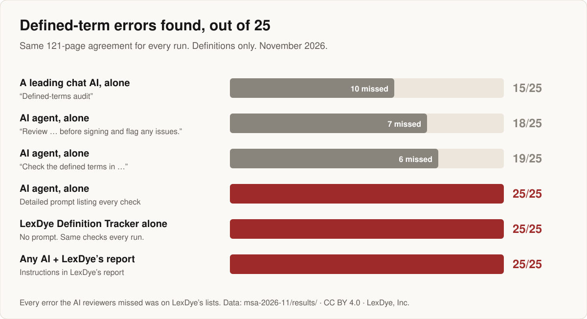

# AI agents miss ~1 in 4 defined-term errors unless told exactly what to check

**An open benchmark for AI contract review: a 121-page agreement, 25 planted defined-term errors, and a machine-readable answer key. Run your own model and score it in one command.**

Also on Hugging Face: [LexDye/definition-benchmark](https://huggingface.co/datasets/LexDye/definition-benchmark) (load the answer key and results with the `datasets` library).

   



## Results

Same agreement for every run. Only defined-term errors were scored.

| Reviewer | LexDye report given? | Prompt | Run date | Errors found |
|---|---|---|---|---|
| A leading chat AI | No | A defined-terms audit of the agreement | Nov 12, 2026 | **15 / 25** |
| AI agent | No | "Review myAgreement.docx before signing and flag any issues." | Nov 19, 2026 | **18 / 25** |
| AI agent | No | "Check the defined terms in myAgreement.docx." | Nov 19, 2026 | **19 / 25** |
| AI agent | No | A detailed prompt listing every check LexDye runs | Nov 19, 2026 | **25 / 25** |
| LexDye Definition Tracker alone | (is the report) | None. LexDye runs the same checks every time. | Nov 2026 | **25 / 25** |
| Chat AI or AI agent with LexDye's report | Yes | The instructions in LexDye's report | Nov 2026 | **25 / 25** |

**What this shows**

- **The prompt decides the score.** The same agent, on the same agreement, scored 18, 19, or 25 depending only on what it was asked.
- **Everyday prompts skip whole checks.** With "check the defined terms," the agent never looked for lower-case uses of defined terms. With "review before signing," it skipped unused terms, identical duplicates, and use before definition.
- **False findings.** The chat AI reported five properly defined terms as undefined and rated two of them "High" risk. None of the agent runs called a defined term undefined.
- **Every miss was on LexDye's lists.** Given LexDye's report, every AI found 25 of 25.

Full write-up: [AI only checks what it's asked to check](https://www.lexdye.com/blog/defined-terms-benchmark-msa-2026-11) · Item-by-item answer key: [lexdye.com](https://www.lexdye.com/blog/defined-terms-benchmark-msa-2026-11-answer-key)

## What's in this repository

| Path | What it is |
|---|---|
| [`msa-2026-11/agreement.docx`](msa-2026-11/agreement.docx) | The test agreement. Fictional IT and business process outsourcing MSA between a bank and a technology supplier: about 121 pages, a Clause 1.1 glossary, 12 schedules, 372 definitions. The exact file every reviewer received. |
| [`msa-2026-11/answer-key.json`](msa-2026-11/answer-key.json) · [`.csv`](msa-2026-11/answer-key.csv) | All 31 planted errors (25 scored) with ID, category, location, quoted text, and note. Also the 12 tricky-but-correct items. |
| [`msa-2026-11/tricky-but-correct.csv`](msa-2026-11/tricky-but-correct.csv) | 12 items that look wrong but are correct. Flagging them is a false positive. |
| [`msa-2026-11/results/`](msa-2026-11/results/) | Item-by-item results for every run, plus summary CSV and JSON. |
| [`msa-2026-11/prompts/`](msa-2026-11/prompts/) | The prompts used for each run. |
| [`submissions/`](submissions/) | Each run in the submission format, plus `TEMPLATE.json`. |
| [`score.py`](score.py) | Scorer. Python 3, standard library only. |

### The 25 scored errors

| Category | Count | Example |
|---|---|---|
| `lower_case_use`: lower-case use of a defined term | 5 | "change control procedure" for Change Control Procedure |
| `variant_or_misspelling`: misspelled or variant form | 5 | "Key Personel", "Service-Level Credit" |
| `defined_not_used`: defined but never used | 4 | "Work Product" |
| `undefined_term`: capitalized term never defined | 3 | "Remediation Plan" |
| `duplicate_conflicting`: defined twice, conflicting | 3 | "Change of Control" at more than 50% and at 30% |
| `duplicate_identical`: defined twice, identically | 2 | "Security Incident" |
| `schedule_term_outside_schedule`: schedule-only term used in the main body | 2 | "RTO" |
| `used_before_defined`: used before its definition | 1 | "Innovation Fund" |

**Not scored (6):** two straight-quote definitions (quotation style), three glossary entries that point to the wrong clause (cross-references), and E14 ("Service Integrator"), which was dropped from scoring after drafting. The agreement really does leave "Service Integrator" undefined, so a reviewer that flags it is correct, but the item counts for no one.

## Run your own model

1. Give [`msa-2026-11/agreement.docx`](msa-2026-11/agreement.docx) to your model, agent, or tool. Rename it if you like (our runs used `myAgreement.docx`). Use whatever prompt you want to test.
2. Match each finding to an error ID in [`answer-key.csv`](msa-2026-11/answer-key.csv). Count a finding only if it identifies the term and the problem at the right place.
3. Copy [`submissions/TEMPLATE.json`](submissions/TEMPLATE.json) and fill it in:

```json
{
  "benchmark": "msa-2026-11",
  "reviewer": "Your model or tool, as you want it shown",
  "harness": "chat | agent | tool",
  "model": "exact model name and version",
  "prompt": "the exact prompt you used",
  "lexdye_report_given": false,
  "run_date": "2026-11-20",
  "found": ["E3", "E4", "E5"],
  "flagged_correct_items": [],
  "false_undefined_claims": 0,
  "notes": "anything a reader needs to reproduce the run",
  "submitted_by": "your name or handle"
}
```

4. Score it:

```bash
python3 score.py submissions/my-run.json   # score, per-category breakdown, misses
python3 score.py submissions/*.json        # leaderboard of all runs
```

A CSV with columns `id,found` (1 or 0) works too: `python3 score.py my-run.csv`.

To add your result, open a pull request with your JSON file in `submissions/`. Please include the exact prompt, model, and date so anyone can reproduce it.

**Scoring rules:** score only defined-term errors; don't credit quotation style, cross-references, meaning, or commercial points, even when a reviewer raises them correctly. Results vary by run, prompt, and model, so report how many runs you did.

## Method

- **Scope.** Only defined-term errors. Commercial points, meaning, drafting quality, quotation style, and section cross-references were not scored.
- **Chat AI.** A leading general-purpose chat AI received the agreement and was asked for a defined-terms audit. It worked as a chat assistant, without running its own scripts.
- **AI agent.** An AI agent that runs on the user's own computer and can read files and write its own scripts. Each run started in a fresh session, in a folder that held only the agreement. Only the prompt changed between runs. A full review took about five minutes.
- **LexDye alone.** The LexDye Definition Tracker (browser version, beta, November 2026) opened the Word file directly. The result is the same on every run.
- **AI with LexDye.** The AI received the agreement and LexDye's report, which includes line-numbered text and instructions to triage every entry. The agent run used the LexDye command-line version (beta build 2026-11-17a) and triaged all 454 report entries.
- **Scoring.** Item by item against the answer key written when the errors were planted. Rescored to the definitions-only scope (25 errors) on November 19, 2026.

**Limitations.** One fictional agreement and a small number of runs. Planted errors are clean slips; real negotiated drafts are messier. The AI reviewers also found real issues outside this test's scope, which is the judgment work LexDye leaves to the AI and the lawyer. LexDye errs on the side of flagging for review, so its report also lists entries that turn out to be fine; the AI's job is to sort them.

## About LexDye

The [LexDye Definition Tracker](https://www.lexdye.com/definition-tracker) is a completeness layer for AI review of defined terms. It runs on your own computer, offline, and lists every defined term that is undefined, duplicated, unused, used before its definition, or used in lower case. Your AI then triages one report.

**LexDye finds them. Your AI reviews them. You don't have to.**

- **Try the free beta:** [lexdye.com/definition-tracker-beta](https://www.lexdye.com/definition-tracker-beta) (access code **06511**). Browser app for Mac and Windows, plus a command-line version for AI agents.
- **Blog and benchmarks:** [lexdye.com/blog](https://www.lexdye.com/blog)
- **Contact:** info@lexdye.com

## License

- **Benchmark materials** (agreement, answer key, results, prompts, and documentation): [Creative Commons Attribution 4.0 International (CC BY 4.0)](LICENSE). Please credit "LexDye, Inc." and link to this repository.
- **`score.py`:** [MIT License](LICENSE-CODE).
- **LexDye software is not included and is not open source.** The LexDye Definition Tracker, its command-line version, and its AI instructions are proprietary software of LexDye, Inc., licensed only under the [LexDye Terms of Use](https://www.lexdye.com/definition-tracker-license). Nothing in this repository grants any right in LexDye software.

The agreement is entirely fictional. Any resemblance to real companies or people is coincidental. Nothing here is legal advice.

## Citation

LexDye, Inc., *LexDye Defined-Terms Benchmark: 121-Page MSA (November 2026)*, https://github.com/LexDye/definition-benchmark (also at https://huggingface.co/datasets/LexDye/definition-benchmark). See [`CITATION.cff`](CITATION.cff), or use GitHub's "Cite this repository" button.
